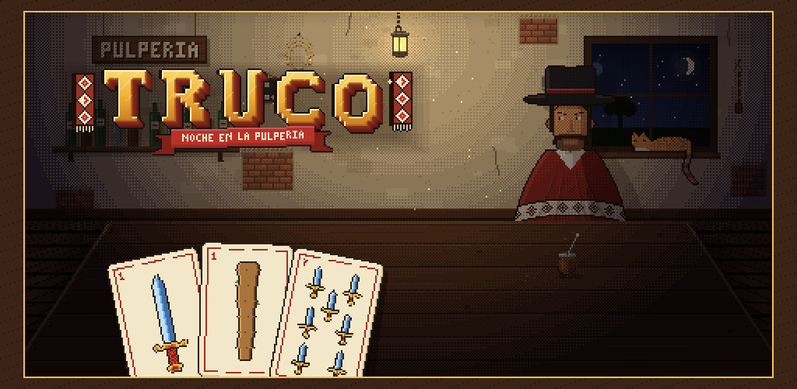

  

  <b>Estudio independiente de videojuegos, hecho en Argentina.</b> 
  <i>Independent game studio from Argentina.</i>

  <a href="https://hollowfiregames.github.io">Sitio web</a> ·
  <a href="mailto:hollowfire.games@gmail.com">Contacto</a>

  
  
  
  

---

## 🔥 En el fogón / What we're making

### Truco: Noche en la pulpería

Truco argentino 1 contra 1, con flor, en pixel art, en una pulpería de la pampa del siglo XIX. Jugale a los personajes del campo: cada uno habla a su manera, tiene su voz y miente distinto. Y si te animás, la yapa: un camino de rivales hasta medianoche, con cábalas, eventos y un jefe que te espera al final.

*Argentine truco, the classic bluffing card game, in pixel art, set in a 19th-century country store on the pampas. Every rival talks, sounds and bluffs in their own way.*

**Próximamente en Google Play** · *Coming soon to Google Play*

---

## Cómo trabajamos / How we work

- **Con rigor histórico:** gauchos, pulperías y habla rioplatense del siglo XIX, estudiados antes de dibujar o escribir.
  *Historically grounded in 19th-century Río de la Plata culture.*
- **Para jugadores nuevos:** poco texto en pantalla y una curva de aprendizaje suave.
  *Easy to pick up, with little text on screen.*

Hecho con cariño en Argentina · Made with love in Argentina

